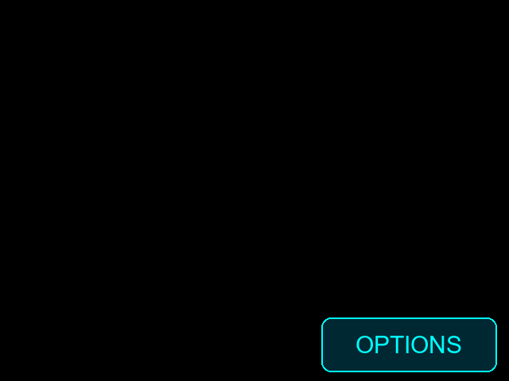
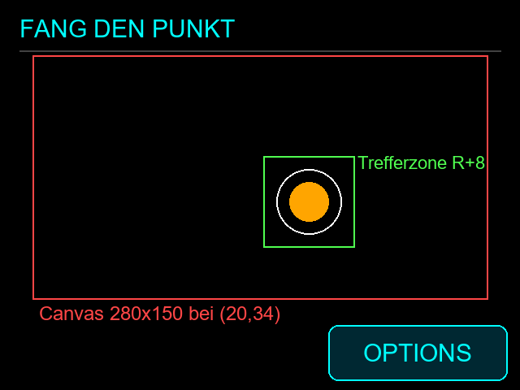
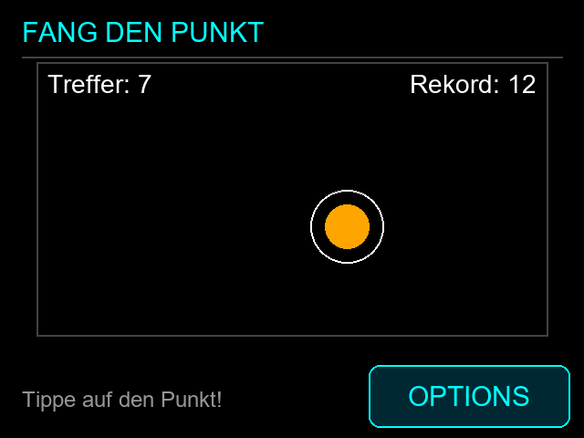

# Tutorial 3: „Fang den Punkt" (ca. 30 Minuten)

Ziel: Ein Punkt springt auf dem Display umher. Wer ihn antippt, bekommt einen Punkt. Je mehr Treffer, desto kürzer bleibt er stehen. Verpasst man ihn, endet die Runde, der Rekord wird gespeichert.

> Die Bilder sind **simulierte Nachzeichnungen** (erzeugt mit `scripts/make_tutorial_images.py`), keine Fotos.
> Fertige Lösung: [`tutorial/spiel/app.cpp`](../tutorial/spiel/app.cpp)

## 0. Vorbereitung (3 min)

Projekt öffnen, Environment wählen, flashen. Der Startscreen ist leer:



Alles Eigene kommt in [`src/app.cpp`](../src/app.cpp). Touch, Display und Speicher sind fertig.

## 1. Das Layout verstehen (3 min)



| Hook | Aufgabe |
|---|---|
| `appSetup` | Spielfeld (Canvas) anlegen, Rekord laden |
| `appLoop` | Spiellogik: Zeit abgelaufen? |
| `appDrawAnimation` | Spielfeld zeichnen (ca. 30× pro Sekunde) |
| `appHandleTouch` | Treffer prüfen |
| `appDrawHome` | Titel und Hinweis |

**Warum getrennt?** Logik (was passiert) und Zeichnen (wie es aussieht) zu trennen hält Code lesbar.

## 2. Includes, Konstanten, Variablen (5 min)

```cpp
#include "colors.h"
#include "config.h"
#include "display.h"
#include "settings.h"   // preferences (Speicher)
#include "ui.h"         // currentScreen()

namespace {
constexpr int16_t FIELD_X = 20, FIELD_Y = 34;
constexpr int16_t FIELD_WIDTH = 280, FIELD_HEIGHT = 150;
constexpr int16_t TARGET_RADIUS = 20;
constexpr int16_t TOUCH_TOLERANCE = 8;
constexpr uint16_t FRAME_INTERVAL_MS = 33;       // ca. 30 Bilder/s
constexpr uint32_t START_LIFETIME_MS = 1500;
constexpr uint32_t MIN_LIFETIME_MS = 500;
constexpr uint32_t LIFETIME_STEP_MS = 50;

uint16_t score = 0, highScore = 0;
int16_t targetX = 0, targetY = 0;                // relativ zum Spielfeld
uint32_t targetMovedAt = 0;
}
```

**Warum `namespace { }`?** Die Variablen sind nur in dieser Datei sichtbar, das vermeidet Namenskonflikte.

## 3. Spielfeld anlegen (3 min)

```cpp
void appSetup() {
  animationCanvasCreate(FIELD_X, FIELD_Y, FIELD_WIDTH, FIELD_HEIGHT,
                        FRAME_INTERVAL_MS, 8);
  highScore = preferences.getUInt("hiscore", 0);
  moveTarget(millis());
}
```

**Warum die `8`?** Die letzte Zahl ist die Farbtiefe. 8 Bit halbiert den Speicher (42 KB statt 84 KB). Der Preis: sehr dunkle Farben werden schwarz. Das Spielfeld ist schwarz mit hellen Farben, also passt das. (Eine Uhr mit dunkelgrauem Hintergrund bräuchte 16 Bit.)

## 4. Punkt bewegen und Runde beenden (5 min)

Diese Funktionen stehen im `namespace` **vor** `appSetup`:

```cpp
uint32_t lifetimeMs() {                           // wird mit Treffern kürzer
  const uint32_t reduction = score * LIFETIME_STEP_MS;
  return reduction >= START_LIFETIME_MS - MIN_LIFETIME_MS
             ? MIN_LIFETIME_MS : START_LIFETIME_MS - reduction;
}

void moveTarget(uint32_t now) {
  targetX = random(TARGET_RADIUS, FIELD_WIDTH - TARGET_RADIUS);
  targetY = random(TARGET_RADIUS + 18, FIELD_HEIGHT - TARGET_RADIUS);
  targetMovedAt = now;
}

void endRound() {
  if (score > highScore) {
    highScore = score;
    settingSaved(preferences.putUInt("hiscore", highScore), "high score");
  }
  score = 0;
}
```

**Warum?**
- Der Mindestabstand zum Rand (`TARGET_RADIUS`) hält den Kreis im Feld, `+ 18` lässt oben Platz für die Punktezeile.
- Rekord nur bei Verbesserung speichern: Flash-Speicher verträgt nur begrenzt viele Schreibvorgänge.

## 5. Spiellogik in `appLoop()` (3 min)

```cpp
void appLoop(uint32_t now) {
  if (currentScreen() != Screen::Home) {   // Menü offen: Spiel pausiert
    targetMovedAt = now;
    return;
  }
  if (now - targetMovedAt >= lifetimeMs()) {
    endRound();
    moveTarget(now);
  }
}
```

**Warum prüfen wir den Screen?** Das Spiel läuft im Hintergrund weiter, auch wenn das Optionsmenü offen ist. Ohne Prüfung ginge die Runde dort verloren.

## 6. Zeichnen (5 min)

```cpp
void appDrawHome(TFT_eSPI &gfx) {
  gfx.setTextDatum(TL_DATUM);
  gfx.setTextColor(TFT_CYAN, backgroundColor);
  gfx.drawString("FANG DEN PUNKT", 12, 9, 2);
  gfx.drawFastHLine(12, 31, DISPLAY_WIDTH - 24, 0x4208);
  gfx.setTextColor(TEXT_MUTED, backgroundColor);
  gfx.drawString("Tippe auf den Punkt!", 12, 212, 2);
}

void appDrawAnimation(TFT_eSprite &canvas, uint32_t now) {
  canvas.fillSprite(TFT_BLACK);
  canvas.drawRect(0, 0, FIELD_WIDTH, FIELD_HEIGHT, 0x4208);

  const uint32_t age = min<uint32_t>(now - targetMovedAt, lifetimeMs());
  const int16_t inner = TARGET_RADIUS * (lifetimeMs() - age) / lifetimeMs();
  canvas.drawCircle(targetX, targetY, TARGET_RADIUS, TFT_WHITE);
  canvas.fillCircle(targetX, targetY, inner, TFT_ORANGE);

  canvas.setTextColor(TFT_WHITE, TFT_BLACK);
  canvas.setTextDatum(TL_DATUM);
  canvas.drawString(String("Treffer: ") + score, 6, 4, 2);
  canvas.setTextDatum(TR_DATUM);
  canvas.drawString(String("Rekord: ") + highScore, FIELD_WIDTH - 6, 4, 2);
}
```

**Warum?** Der weiße Ring bleibt stehen, die orange Füllung schrumpft: So sieht man, wie lange der Punkt noch bleibt (Animation).

## 7. Touch (5 min)

```cpp
bool appHandleTouch(int16_t x, int16_t y) {
  const int16_t dx = x - (FIELD_X + targetX);   // Display- in Feldkoordinaten
  const int16_t dy = y - (FIELD_Y + targetY);
  const int16_t reach = TARGET_RADIUS + TOUCH_TOLERANCE;
  if (dx * dx + dy * dy > reach * reach) {
    return false;                               // daneben
  }
  ++score;
  moveTarget(millis());
  return true;
}
```

**Warum?** Touch-Koordinaten gelten für das ganze Display, der Punkt liegt aber relativ zum Spielfeld, daher `FIELD_X + targetX`. Der Satz des Pythagoras (`dx² + dy²`) vermeidet eine Wurzel. `TOUCH_TOLERANCE` macht das Treffen fairer. Der OPTIONS-Button wird vom Framework zuerst geprüft und stört nicht.

## 8. Ergebnis



Die Lösung wurde für `esp32dev-fast` und `fnk0114l-low-memory` gebaut, aber noch nicht auf echter Hardware getestet.

## Ausbau-Ideen

- Ton bei Treffer (Tongenerator fehlt noch, bietet sich als Aufgabe an).
- Punkt wird bei höheren Stufen kleiner oder bunter.
- Mehrere Punkte gleichzeitig, Leben statt sofortigem Rundenende.

## Fehlersuche

| Problem | Ursache |
|---|---|
| Spielfeld fehlt | Canvas nicht angelegt oder zu wenig RAM (Serial-Log) |
| Treffer wird nicht erkannt | Feldversatz `FIELD_X`/`FIELD_Y` vergessen |
| Rekord weg nach Neustart | `preferences.putUInt` nicht aufgerufen |
| Text zu groß | `setTextSize` nicht zurückgesetzt |
