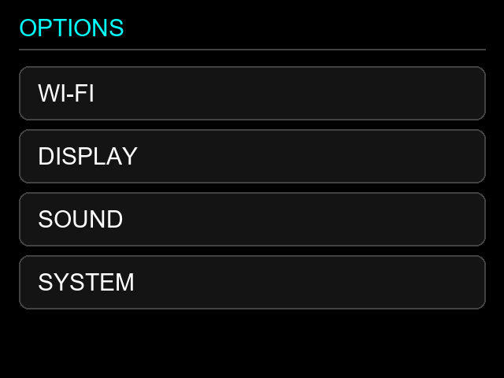
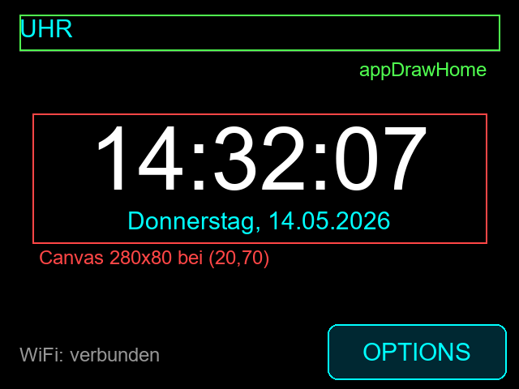
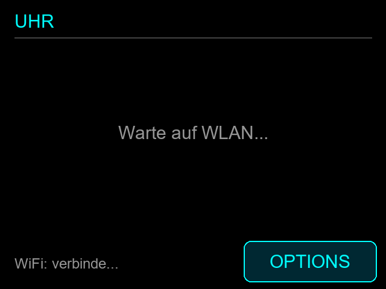
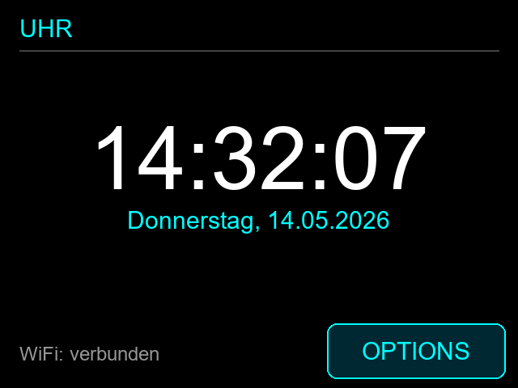

# Tutorial 1: WLAN-Uhr (ca. 30 Minuten)

Ziel: Der Startscreen zeigt Uhrzeit und Datum. Die Zeit holt sich das CYD per WLAN (NTP).

> Die Bilder sind **simulierte Nachzeichnungen** des Displays (erzeugt mit `scripts/make_tutorial_images.py`), keine Fotos.
> Fertige Lösung: [`tutorial/uhr/app.cpp`](../tutorial/uhr/app.cpp)

## 0. Vorbereitung (5 min)

1. Projekt in VS Code mit PlatformIO öffnen, passendes Environment wählen (z. B. `esp32dev-fast`).
2. Flashen. Der Startscreen ist leer und zeigt nur OPTIONS:

   

3. OPTIONS → WI-FI: WLAN einrichten (NTP läuft danach automatisch, Zeitzone `TIMEZONE` in `include/config.h`).



**Warum nur eine Datei?** Alles eigene gehört in [`src/app.cpp`](../src/app.cpp). WLAN, Touch, Menü und Zeichnen sind bereits fertig.

## 1. Das Layout verstehen (3 min)



| Teil | Hook in `app.cpp` | Wann aufgerufen |
|---|---|---|
| Titel, WLAN-Status (grün) | `appDrawHome` | bei jedem Neuzeichnen des Screens |
| Uhr (rot) | `appDrawAnimation` | im eigenen Takt (hier 1× pro Sekunde) |

**Warum ein Canvas?** Die Uhr ändert sich jede Sekunde. Ein Canvas ist ein kleiner Bildbereich, der allein aktualisiert wird. So muss nicht der ganze Screen neu gezeichnet werden (kein Flackern).

## 2. Includes und Konstanten (5 min)

Oben in `src/app.cpp` ergänzen:

```cpp
#include <time.h>
#include "colors.h"
#include "config.h"
#include "display.h"
#include "network.h"

namespace {
constexpr int16_t CLOCK_X = 20, CLOCK_Y = 70;
constexpr int16_t CLOCK_WIDTH = 280, CLOCK_HEIGHT = 80;
constexpr uint16_t CLOCK_INTERVAL_MS = 1000;
constexpr time_t MIN_VALID_TIME = 1609459200;  // 1.1.2021
const char *const WEEKDAYS[] = {"Sonntag", "Montag", "Dienstag", "Mittwoch",
                                "Donnerstag", "Freitag", "Samstag"};
}
```

**Warum?** Feste Zahlen mit Namen machen später das Ändern leicht. `MIN_VALID_TIME` erkennt, ob die Uhr schon per NTP gestellt wurde (vorher steht sie auf 1970).

## 3. Canvas anlegen in `appSetup()` (2 min)

```cpp
void appSetup() {
  animationCanvasCreate(CLOCK_X, CLOCK_Y, CLOCK_WIDTH, CLOCK_HEIGHT,
                        CLOCK_INTERVAL_MS);
}
```

**Warum hier?** `appSetup` läuft einmal beim Start, nachdem Display, WLAN und Einstellungen bereit sind. Standard ist 16 Bit Farbtiefe (280×80 = ca. 45 KB), damit der dunkle Hintergrund richtig dargestellt wird.

## 4. Statischen Teil zeichnen in `appDrawHome()` (5 min)

```cpp
void appDrawHome(TFT_eSPI &gfx) {
  gfx.setTextDatum(TL_DATUM);
  gfx.setTextColor(TFT_CYAN, backgroundColor);
  gfx.drawString("UHR", 12, 9, 2);
  gfx.drawFastHLine(12, 31, DISPLAY_WIDTH - 24, 0x4208);
  gfx.setTextColor(TEXT_MUTED, backgroundColor);
  gfx.drawString(fittedText(wifiStatusText(), 180, 2), 12, 212, 2);
}
```

**Warum?** Titel und Status ändern sich selten. Das letzte Argument `2` ist die Schriftart (Font 2). Der Text bleibt links von OPTIONS (x < 202).

## 5. Die Uhr zeichnen in `appDrawAnimation()` (10 min)

```cpp
void appDrawAnimation(TFT_eSprite &canvas, uint32_t now) {
  (void)now;
  canvas.fillSprite(backgroundColor);          // 1. Alles löschen
  canvas.setTextDatum(MC_DATUM);               // Text mittig ausrichten

  const time_t raw = time(nullptr);
  if (raw < MIN_VALID_TIME) {                  // 2. Noch keine Zeit?
    canvas.setTextColor(TEXT_MUTED, backgroundColor);
    canvas.drawString("Warte auf WLAN...", CLOCK_WIDTH / 2, CLOCK_HEIGHT / 2, 2);
    return;
  }

  struct tm t;
  localtime_r(&raw, &t);                       // 3. Sekunden -> Uhrzeit (Zeitzone)
  char text[16];

  strftime(text, sizeof(text), "%H:%M:%S", &t);
  canvas.setTextColor(TFT_WHITE, backgroundColor);
  canvas.setTextSize(3);                       // 4. Große Schrift
  canvas.drawString(text, CLOCK_WIDTH / 2, 28, 2);
  canvas.setTextSize(1);                       //    unbedingt zurücksetzen!

  strftime(text, sizeof(text), "%d.%m.%Y", &t);
  canvas.setTextColor(TFT_CYAN, backgroundColor);
  canvas.drawString(String(WEEKDAYS[t.tm_wday]) + ", " + text,
                    CLOCK_WIDTH / 2, 66, 2);
}
```

**Warum so?**
- Jeder Frame beginnt mit `fillSprite`, sonst überlagern sich alte und neue Ziffern.
- Koordinaten im Canvas gelten relativ zur Canvas-Ecke (0,0), nicht zum Display.
- Es gibt nur zwei kleine Schriften. Größere Zeichen entstehen mit `setTextSize(3)`. Danach muss `setTextSize(1)` folgen, sonst wird alles Weitere zu groß.
- `tm_wday` zählt ab Sonntag = 0.

Während das WLAN verbindet:



## 6. Ergebnis



Bau und Upload, WLAN verbinden, Uhr läuft. Die Lösung wurde für `esp32dev-fast` und `fnk0114l-low-memory` gebaut, aber noch nicht auf echter Hardware getestet.

## Ausbau-Ideen

- Zeitzone ändern: `TIMEZONE` in `include/config.h`.
- Farbe der Uhr ändern (`TFT_WHITE` → `TFT_GREEN`).
- Sekunden-Doppelpunkt blinken lassen (`now / 500 % 2`).
- Touch: `appHandleTouch` schaltet zwischen 24h und 12h um (dann `markUiDirty()` aus `ui.h` nicht vergessen, falls Home-Inhalt wechselt).

## Fehlersuche

| Problem | Ursache |
|---|---|
| „Warte auf WLAN..." bleibt | WLAN nicht eingerichtet, kein Internet |
| Uhr zeigt falsche Stunde | `TIMEZONE` in `config.h` prüfen |
| Alles Folgende zu groß | `setTextSize(1)` vergessen |
| Nichts sichtbar | `animationCanvasCreate` nicht in `appSetup` oder zu wenig Speicher (Serial-Log prüfen) |
